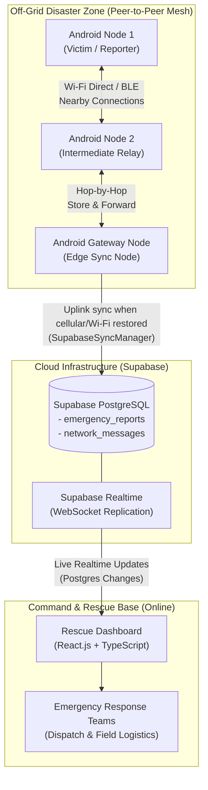

# ResQSync AI - System Architecture

ResQSync AI is an emergency disaster response and off-grid coordination platform. It bridges offline peer-to-peer mobile mesh networks with cloud emergency dispatch systems.

---

## 1. High-Level Architecture Overview

---

## 2. Component Breakdown

### 2.1 `android-app` (Native Kotlin Android Application)
- **Primary Role:** Field data capture, local edge AI assessment, and offline peer-to-peer mesh propagation.
- **Key Modules:**
  - `ui/`: Modern Jetpack Compose UI (HomeScreen, ReportScreen, ReportsScreen, NetworkScreen, SettingsScreen).
  - `database/`: Room database caching local messages (`NetworkMessageEntity`) and emergency incidents (`EmergencyReportEntity`).
  - `ai/`: `HybridAIEngine.kt` evaluating report severity, urgency classification, and generating triage summaries on-device.
  - `networking/`: Google Play Services Nearby Connections API managing peer discovery, BLE/Wi-Fi Direct connections, hop counting, and store-and-forward message routing.
  - `sync/`: `SupabaseSyncManager.kt` detecting internet connectivity (`NET_CAPABILITY_INTERNET`, `NET_CAPABILITY_VALIDATED`) and uploading unsynced reports to Supabase when a backhaul connection is available.
- **Build Tool:** Gradle with Kotlin DSL (`build.gradle.kts`, `settings.gradle.kts`).

---

### 2.2 `rescue-dashboard` (Web Command & Coordination Dashboard)
- **Primary Role:** Operational dispatch map, incident filtering, and real-time disaster monitoring for rescue coordinators.
- **Key Modules:**
  - `IncidentMap.tsx`: Visualization of GPS-tagged disaster incidents and rescue details.
  - `IncidentList.tsx`: Urgency-prioritized list of incoming emergency reports with type/urgency filters.
  - `Header.tsx`: Real-time status indicators (total alerts, critical count, Supabase Live connection state).
  - `services/supabaseClient.ts`: Direct integration with Supabase PostgREST queries and Supabase Realtime subscriptions.
- **Tech Stack:** React 18, TypeScript, Supabase JS Client (`@supabase/supabase-js`).

---

### 2.3 Shared Supabase Backend
- **Unified Data Schema:** Both the Android app and the React dashboard share the exact same database structure for `emergency_reports` and `network_messages`.
- **Decoupled Environments:**
  - Android application reads Supabase configuration from local environment / keystore / `local.properties`.
  - React dashboard reads Supabase configuration from `rescue-dashboard/.env` (`REACT_APP_SUPABASE_URL` and `REACT_APP_SUPABASE_ANON_KEY`).
- **Realtime Push:** When any field smartphone connects to cellular network or satellite uplink, reports inserted into `emergency_reports` are pushed over WebSockets to every connected rescue dashboard operator instantaneously.

---

## 3. Data Contract Mapping

| Field | Android Kotlin Model (`EmergencyReport`) | Supabase Column (`emergency_reports`) | React TS Model (`EmergencyReport`) |
| :--- | :--- | :--- | :--- |
| Report ID | `reportId: String` | `report_id TEXT PRIMARY KEY` | `reportId: string` |
| Reporter ID | `reporterDeviceId: String` | `reporter_device_id TEXT` | `reporterDeviceId: string` |
| Incident Type | `incidentType: IncidentType` | `incident_type TEXT` | `incidentType: IncidentType` |
| Description | `description: String` | `description TEXT` | `description: string` |
| Latitude | `latitude: Double?` | `latitude DOUBLE PRECISION` | `latitude?: number` |
| Longitude | `longitude: Double?` | `longitude DOUBLE PRECISION` | `longitude?: number` |
| Urgency | `urgency: UrgencyLevel` | `urgency TEXT` | `urgency: UrgencyLevel` |
| People Affected | `peopleAffected: Int?` | `people_affected INTEGER` | `peopleAffected?: number` |
| Status | `verificationStatus: VerificationStatus` | `verification_status TEXT` | `verificationStatus: VerificationStatus` |
| AI Summary | `aiSummary: String?` | `ai_summary TEXT` | `aiSummary?: string` |
| Created Timestamp | `createdAt: Long` | `created_at BIGINT` | `createdAt: number` |
